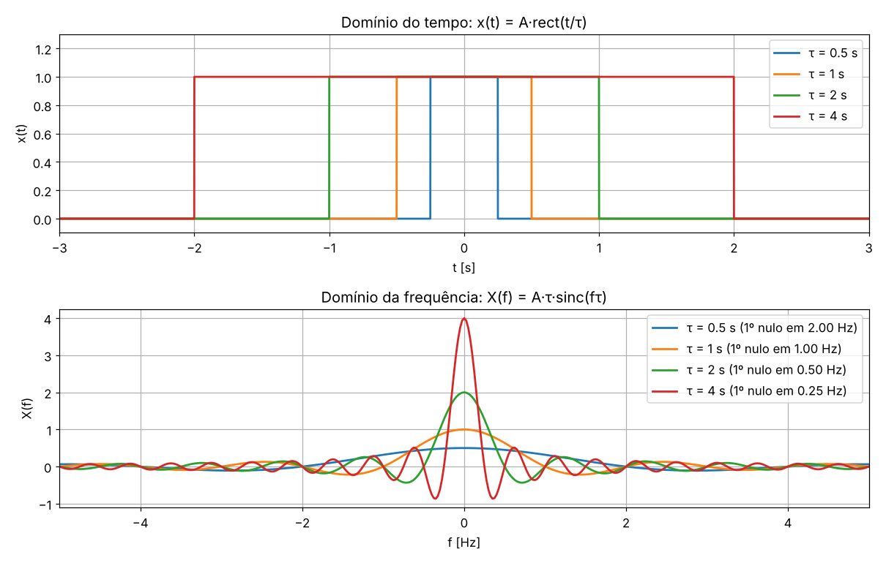
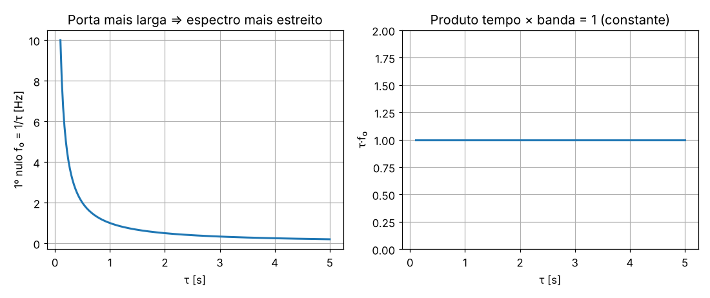
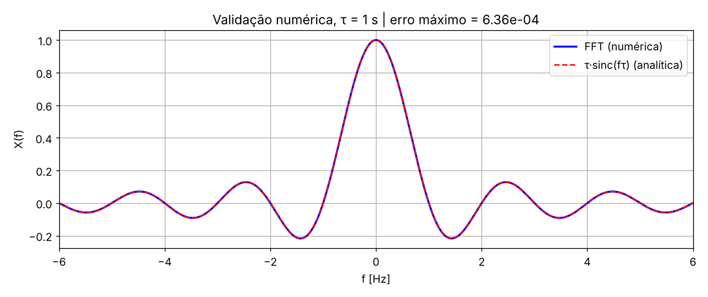
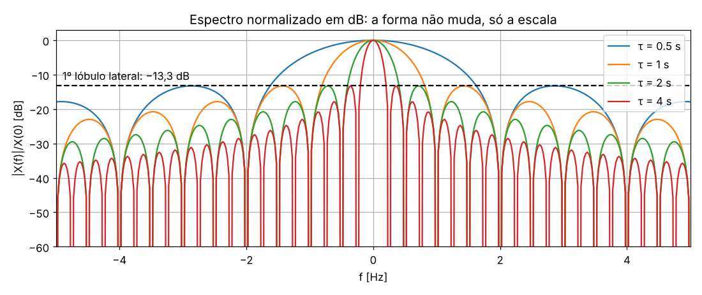
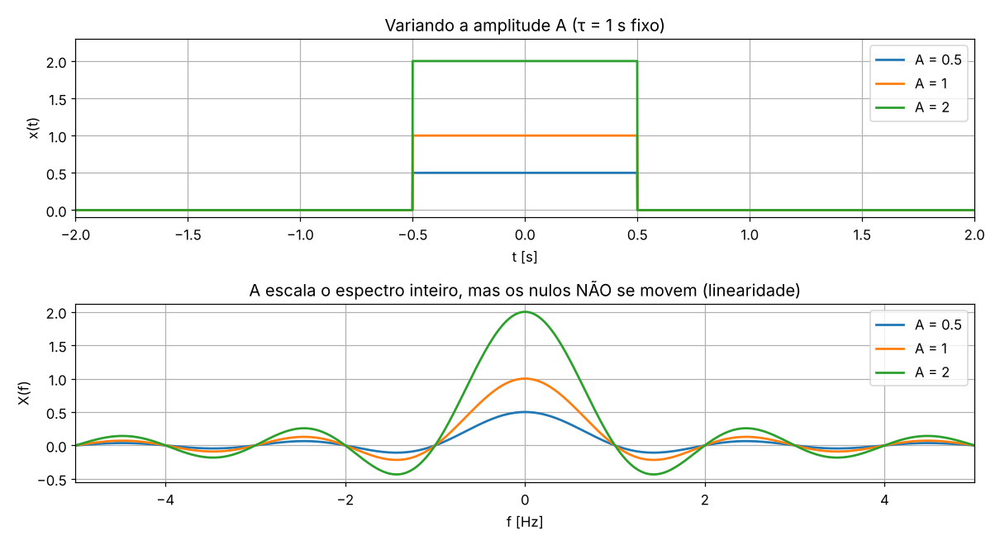
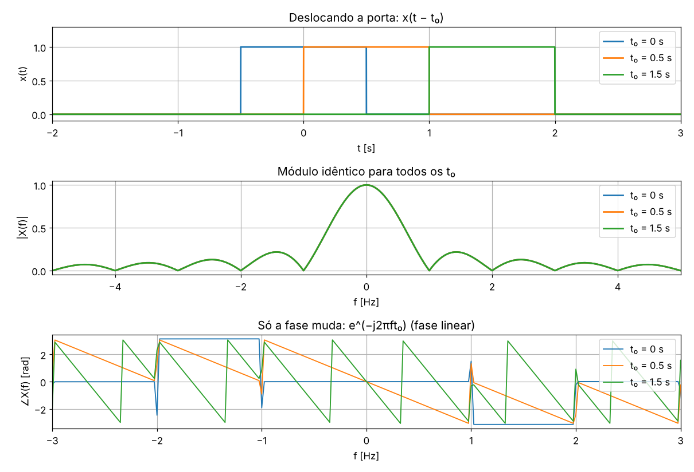

# Transformada de Fourier — RECT ↔ SINC (hands on)

Material de apoio para **Sinais e Sistemas / Processamento Digital de Sinais**.
Prof. Newton Licciardi Jr.

> **Exercício:** faça um programa em MATLAB que permita exercitar a variação de parâmetros do RECT e a sua consequente TF. Reproduza o programa e as figuras para dois parâmetros pelo menos. O que ocorre quando o tamanho da porta aumenta? E vice-versa?

📥 **Download do programa:** [`rect_sinc_tf.m`](rect_sinc_tf.m) (clique no arquivo → botão *Download raw file*)

---

## 1. O par de transformadas

A porta (função retangular) de largura **τ** e amplitude **A**:

$$x(t) = A\,\mathrm{rect}\!\left(\frac{t}{\tau}\right) = \begin{cases} A, & |t| < \tau/2 \\ 0, & |t| > \tau/2 \end{cases}$$

Aplicando a definição da Transformada de Fourier:

$$X(f) = \int_{-\tau/2}^{\tau/2} A\, e^{-j2\pi f t}\, dt = A\,\frac{\sin(\pi f \tau)}{\pi f} = A\,\tau\,\mathrm{sinc}(f\tau)$$

com $\mathrm{sinc}(u) = \dfrac{\sin(\pi u)}{\pi u}$.

| Característica do espectro | Valor | Depende de |
|---|---|---|
| Altura do pico, X(0) | **A·τ** (= área da porta) | A e τ |
| 1º nulo | **f₀ = ±1/τ** | só τ |
| Nulos seguintes | f = ±k/τ, k = 1, 2, 3… | só τ |
| Largura do lóbulo principal | **2/τ** | só τ |
| 1º lóbulo lateral | **−13,3 dB** abaixo do pico | nada (forma fixa) |
| Energia | **A²·τ** | A e τ |

---

## 2. O que acontece quando a porta aumenta (e vice-versa)?

**Porta mais larga (τ ↑):**
- o espectro **fica mais estreito**: o 1º nulo se aproxima da origem (1/τ ↓);
- o pico **fica mais alto** (A·τ ↑), porque a área sob a porta cresceu;
- a energia se concentra nas **baixas frequências**.

**Porta mais estreita (τ ↓):**
- o espectro **se espalha**: o 1º nulo se afasta (1/τ ↑) e é preciso **mais banda** para representar o sinal;
- o pico **fica mais baixo**.

**Caso limite:**
- τ → ∞: a porta vira uma constante, e o espectro vira um impulso δ(f), ou seja, só DC;
- τ → 0 (mantendo a área A·τ = 1): a porta vira um impulso δ(t), e o espectro fica **plano**, com todas as frequências com o mesmo peso.

Essa é a **propriedade de escala** da TF:

$$x(at) \;\longleftrightarrow\; \frac{1}{|a|}\,X\!\left(\frac{f}{a}\right)$$

**Comprimir no tempo expande na frequência, e vice-versa.** É a versão de engenharia do **princípio da incerteza**: não existe sinal que seja, ao mesmo tempo, curtíssimo no tempo e estreitíssimo em frequência.

O produto **τ · (1/τ) = 1** é constante. A duração e a banda trocam entre si, mas o produto não muda.

### Onde isso aparece na vida real
- **Radar:** um pulso curto dá boa resolução de distância, mas exige banda larga. Por isso existe a compressão de pulso (chirp).
- **Comunicações digitais:** símbolos mais curtos (taxa maior) ocupam mais banda. Isso explica por que 5G, Wi-Fi 6 e Wi-Fi 7 precisam de canais de 100 MHz ou mais.
- **OFDM:** cada subportadora é uma porta no tempo, portanto uma sinc em frequência. Os nulos em k/τ são exatamente o que garante a ortogonalidade entre subportadoras.
- **Janelamento em PDS:** truncar um sinal equivale a multiplicá-lo por uma rect, ou seja, a convoluir o espectro com uma sinc. É a origem do vazamento espectral e dos lóbulos de −13 dB.
- **Áudio:** tocar uma gravação em 2× (compressão no tempo) dobra todas as frequências, e o som fica agudo.

---

## 3. Validação: FFT numérica × fórmula analítica

O script calcula a TF de duas formas e compara:
- **numérica:** `fftshift(fft(ifftshift(x)))/fs`, uma aproximação discreta da integral de Fourier;
- **analítica:** `A*tau*sinc(f*tau)`.

O erro máximo é da ordem de 10⁻⁴, limitado pela taxa de amostragem (fs = 1 kHz) e pela janela de observação finita.

### Parseval (conservação de energia)

| τ [s] | Energia no tempo (A²τ) | Energia na frequência (∫\|X\|² df) |
|---|---|---|
| 0,5 | 0,5000 | 0,5000 |
| 1,0 | 1,0000 | 1,0000 |
| 2,0 | 2,0000 | 2,0000 |
| 4,0 | 4,0000 | 4,0000 |

---

## 4. Espectro em dB: a forma da sinc é universal

Normalizado pelo pico, todo espectro de rect tem o **mesmo formato**: o 1º lóbulo lateral fica sempre em −13,3 dB, e os lóbulos seguintes caem a −6 dB por oitava (decaimento proporcional a 1/f). O τ só **estica ou encolhe o eixo f**. A responsável por esse decaimento lento são as **bordas abruptas** da porta (descontinuidades).

---

## 5. Segundo parâmetro: amplitude A

- A **escala o espectro inteiro** verticalmente (linearidade da TF: a·x(t) ↔ a·X(f)).
- **Os nulos não se movem.** A banda ocupada não depende da amplitude.
- A energia cresce com **A²**.

---

## 6. Terceiro parâmetro (bônus): atraso t₀

Propriedade do deslocamento no tempo:

$$x(t - t_0) \;\longleftrightarrow\; X(f)\, e^{-j2\pi f t_0}$$

- O **módulo |X(f)| não muda**: atrasar um sinal não altera o seu conteúdo espectral.
- **Só a fase muda**, e de forma **linear em f** (inclinação −2πt₀). É por isso que um sistema com fase linear não distorce o sinal, apenas o atrasa.
- Para t₀ = 0, os saltos de ±π na fase correspondem às trocas de sinal da sinc (lóbulos negativos).

---

## 7. Como rodar

1. Baixe [`rect_sinc_tf.m`](rect_sinc_tf.m).
2. Abra no MATLAB (**R2018b ou mais recente**) e rode com **F5**.
3. São geradas 6 figuras e a tabela de Parseval no Command Window.
4. Ao final, abre-se a **janela interativa**, com sliders para:
   - **τ** (0,1 a 5 s): veja a sinc encolher e esticar em tempo real;
   - **A** (0,1 a 3): veja o espectro escalar sem mover os nulos;
   - **t₀** (−3 a 3 s): veja o módulo ficar parado.

O script **não precisa de nenhuma toolbox**: a função `sinc` está definida no próprio arquivo.

> As figuras deste repositório foram geradas com o mesmo algoritmo do script (mesmos parâmetros, mesma FFT). Ao rodar no MATLAB, as curvas devem coincidir.

### Desafios para os engenheirandos
1. Qual τ faz o 1º nulo cair em exatamente 2,5 Hz? Confira no slider.
2. Substitua a rect por uma **porta triangular** (tri = rect ∗ rect). O que acontece com os lóbulos laterais? (Dica: sinc².)
3. Repita com um **pulso gaussiano**. Por que a gaussiana é a única função que mantém a mesma forma nos dois domínios?
4. Reduza `fs` para 20 Hz. O que aparece no espectro? (Dica: aliasing.)

---

## Referências
- Oppenheim, A. V.; Willsky, A. S. *Sinais e Sistemas*, 2ª ed. Pearson, cap. 4.
- Lathi, B. P. *Sinais e Sistemas Lineares*, 2ª ed. Bookman, cap. 7.
- Haykin, S.; Van Veen, B. *Sinais e Sistemas*. Bookman, cap. 3.
- [MathWorks – fft](https://www.mathworks.com/help/matlab/ref/fft.html)
